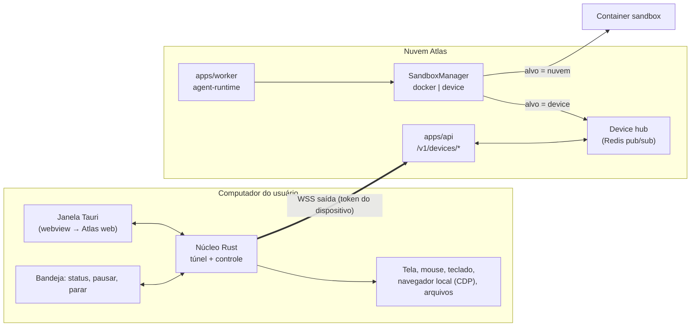

# ADR 0001: app desktop do Atlas em Tauri, com túnel de computer use

- **Status:** proposto (issues #96, #97, #98, #99)
- **Data:** 2026-10-23

## Contexto

Hoje o computer use roda num container na nuvem (`packages/sandbox`): o agent-runtime chama o `SandboxManager` (`execScreenshot`, `execClick`, `execType`, `execBrowserAct`, `execShell`…), que fala HTTP com um **servidor de controle** dentro do container (`control-client.ts` → `/navigate`, `/screen`, …).

Queremos que o bot também use o **computador do usuário**: os sites onde ele já está logado, os arquivos e os apps locais. A base é um app desktop leve que, depois do login, mostra os mesmos bots e conversas da nuvem.

## Decisão

1. **Casca em Tauri 2** (Rust + webview do sistema), carregando o Atlas web já hospedado (`ATLAS_URL`). Não empacotamos o Next: o app é uma janela para a nuvem, mais o processo nativo de controle.
2. **O computador local é mais um backend do `SandboxManager`.** O app implementa o **mesmo protocolo de controle** que o container já expõe. Assim o agent-runtime, as tools e os testes não mudam, só a escolha do alvo.
3. **Túnel reverso de saída.** O app abre um WebSocket TLS para a API (`wss://…/v1/devices/tunnel`). A API repassa as chamadas de controle por esse canal. Nenhuma porta abre na máquina do usuário e não precisa de NAT nem de firewall.
4. **A nuvem é a fonte da verdade.** Bots, conversas, rotinas, painéis e memória ficam no servidor, e o app só os lê e assina eventos. Sem banco local além do cache.
5. **Login por navegador com deep link (`atlas://`)**, emitindo um token de dispositivo revogável. Nenhuma senha passa pelo app.
6. **Windows primeiro.** O dono só tem Windows para testar: a primeira versão sai só para Windows 10/11 (WebView2, UI Automation, SendInput). macOS e Linux entram depois, quando houver como testar de verdade (ver "Plataformas").
7. **Usar o computador como o Claude desktop:** agir pela **árvore de acessibilidade** (elementos com nome) e não só por coordenada; usar o **navegador do usuário** por extensão; **permissão por app em níveis**; **ferramentas locais (MCP)** expostas ao bot; atalho global para chamar o Atlas.

## Arquitetura

### Componentes novos

| Onde | O quê |
|---|---|
| `apps/desktop/` (novo) | Projeto Tauri: `src-tauri/` (Rust) + uma página local mínima (login, estado offline). A janela principal carrega `ATLAS_URL`. |
| `apps/desktop/src-tauri/src/control/` | Implementação do protocolo de controle: captura de tela (`xcap`), entrada (`enigo`/SendInput), shell e arquivos só em pastas liberadas. |
| `apps/desktop/src-tauri/src/a11y/` | **Árvore de acessibilidade** (Windows: UI Automation; depois macOS AX e Linux AT-SPI) virando um "snapshot" com ids de elemento, no mesmo formato do `browser_snapshot`; ações por elemento (`invoke`, `set_value`, `select`, `scroll_into_view`). A screenshot vira conferência e fallback para o que não expõe estrutura (canvas, jogos). Novas ops no protocolo: `app_snapshot`, `app_act`, `app_list`, `app_focus`. |
| `apps/desktop/extension/` | Extensão do Atlas para Chrome/Edge (Manifest V3) conectada ao app por native messaging: usa **as abas e os logins do usuário**, lê a página como texto/árvore e age nos elementos (as mesmas ops `browser_*`). Alternativa mais segura e padrão nas rotinas: perfil dedicado do Atlas por CDP. |
| `apps/desktop/src-tauri/src/mcp/` | Hospedeiro de **MCPs locais** (arquivos, Office/Excel aberto, terminal, apps instalados) cujas tools aparecem para o bot pelo túnel como um conector "Meu computador", com as mesmas permissões e confirmações dos conectores da nuvem. |
| `apps/desktop/src-tauri/src/tunnel/` | Cliente WSS com reconexão (backoff), heartbeat, multiplexação de requisições (id por chamada) e limite de tamanho por mensagem. |
| `packages/sandbox/src/device-manager.ts` | `SandboxManager` cujo transporte é o túnel (via hub), com os mesmos tipos de `types.ts`. |
| `packages/db` | Modelos `Device` (userId, nome, SO, versão, `tokenHash`, `lastSeenAt`, `revokedAt`, permissões) e `DeviceAuditEvent`. |
| `apps/api/src/routes/devices.ts` | `POST /v1/devices/pair` (troca código por token), `GET/PATCH/DELETE /v1/devices/:id` (listar, renomear, permissões, revogar), `GET /v1/devices/tunnel` (upgrade WS). Tudo com `requireUser`/`scopeFor`, exceto o túnel, que autentica pelo token do dispositivo. |
| `apps/web` | Configurações → "Dispositivos"; seletor de alvo do computer use por bot ("Nuvem" ou "Meu computador"); aviso no chat "usando seu computador". |

### Protocolo do túnel

- Mensagens JSON com envelope `{id, type, payload}`: `hello` (versão, SO, capacidades), `req`/`res` (uma chamada de controle com `op` igual ao endpoint atual: `screen`, `click`, `type`, `browser_act`…), `event` (pausado, retomado, usuário assumiu o controle), `ping`/`pong`.
- Screenshots em binário (frame separado) com compressão e limite de resolução, como no container.
- Tempo limite por operação igual ao do container. Se o dispositivo cair no meio, a tool falha com erro real e dica ("seu computador desconectou; use a nuvem ou reconecte").
- O worker nunca fala direto com o dispositivo: passa pelo hub da API (Redis pub/sub com a chave `device:<id>`), que confere a cada chamada se o run é do mesmo `userId` do dispositivo.

### Login e sincronização

1. O app abre `ATLAS_URL/desktop/login?code=<código curto>` no navegador padrão.
2. O usuário entra como sempre (better-auth: magic link ou Google) e confirma "Conectar este computador".
3. A API associa o código ao usuário, e o app troca o código por um **token de dispositivo** (256 bits, guardado só o hash no servidor) por deep link `atlas://paired` ou por polling curto.
4. O token fica no cofre do sistema: Keychain, Credential Manager ou Secret Service.
5. A janela usa a sessão web normal. O token do dispositivo serve só para o túnel e para o pareamento.
6. Para sincronizar, nada de cópia local: os dados vêm da API e os eventos em tempo real (o hub que o web já usa). O cache local serve só para abrir rápido e mostrar "offline". Sair do app limpa o cache e fecha o túnel. Revogar no Atlas derruba os dois.

## Segurança

- **Consentimento visível:** enquanto o bot controla a máquina, aparece uma borda e um selo "Atlas está usando seu computador", com o ícone da bandeja animado. Uma tecla de pânico global (por exemplo Ctrl+Alt+Esc) pausa na hora.
- **O usuário assume o controle:** mouse ou teclado reais durante uma ação pausam o bot e emitem o evento `user_took_over`.
- **Permissão por app, em níveis** (como no Claude desktop): na primeira vez que o bot precisa de um app (Excel, Chrome, Explorador…), o app desktop pergunta e o usuário escolhe **ver**, **clicar/digitar** ou **controle total**, e se vale "só agora" ou "sempre". Apps sensíveis (banco, gerenciador de senhas, configurações do sistema) começam bloqueados e sempre perguntam.
- **Permissões por dispositivo:** "só olhar" (screenshot e leitura), navegador do perfil Atlas, apps liberados, pastas liberadas e shell (desligado por padrão). A checagem acontece no **núcleo Rust**, não na nuvem: um servidor comprometido não amplia o acesso.
- **Rotinas e alertas** não usam o computador local por padrão, porque rodam sem você olhando. Para ligar, é preciso permitir explicitamente por rotina.
- **Escopo por dono:** testes de IDOR garantem que o usuário B nunca pareia, lista, revoga nem alcança o dispositivo de A. O hub recusa chamada de run de outro `userId`.
- **Auditoria:** cada ação (tipo, alvo, hora e run) fica em `DeviceAuditEvent`, visível ao usuário.
- **Conteúdo da tela é dado não confiável**, igual ao do container: regra de prompt injection já existente.
- **Sem segredos no túnel:** o cofre do Atlas continua na nuvem, e o app nunca recebe valores do cofre.
- **Atualização assinada** pelo updater do Tauri. As capabilities do Tauri liberam só os comandos nativos necessários, e a webview remota não chama comandos Rust (sem IPC exposto à origem remota, exceto uma ponte mínima e validada para status e pausa).

## Alternativas consideradas

- **Electron:** mais fácil (Node em todo lugar), mas é de 80 a 150 MB e usa mais RAM. O Tauri fica em poucos MB e o Rust ajuda na captura e na entrada com desempenho.
- **Extensão de navegador:** cobre só o navegador, não apps nem arquivos. Pode virar complemento depois.
- **Túnel genérico (ngrok/Cloudflare Tunnel):** expõe uma porta e um serviço de terceiros. O túnel próprio de saída reaproveita a autenticação e o escopo do Atlas.
- **Agente local completo (LLM rodando no PC):** mais privacidade, mas duplica o runtime. A nuvem continua decidindo e o PC só executa.

## Modo "assumir o controle"

Além de agir app por app, o bot pode **assumir o PC inteiro** durante uma tarefa (como o agente do ChatGPT):

- O usuário entrega o controle ("pode assumir") ou já deixou "controle total" liberado. O app mostra uma moldura e um contador ("Atlas no controle · Esc para retomar") e passa a responder sem pedir app por app, exceto nos apps bloqueados.
- O que deixa o controle certeiro: ciclo curto **ver → agir → conferir** em cada passo. Antes de agir, o bot lê a árvore de acessibilidade e a tela. Depois, confere se a tela mudou como esperado; se não mudou, tenta outro caminho (atalho de teclado, outro elemento) antes de seguir.
- Prioridade das ações: atalhos de teclado e ações por elemento, depois clique por coordenada. Screenshots em resolução real da tela (escalada só para o modelo) e com o DPI do Windows considerado.
- Qualquer movimento real de mouse ou teclado do usuário, ou Esc, devolve o controle na hora. O bot recebe o evento e para.
- Fim da tarefa: o controle volta sozinho e o chat mostra o resumo com o que foi feito, e a auditoria guarda cada passo.

## Plataformas

- **Fase 1: só Windows 10/11.** É onde o dono testa. Instalador NSIS/MSI, WebView2 (já vem no Windows 11), UI Automation.
- **Sem certificado pago.** O instalador sai sem assinatura de código: o Windows mostra o SmartScreen ("O Windows protegeu o computador" → "Mais informações" → "Executar assim mesmo"), explicado na página de download. A **integridade das atualizações** não depende de certificado: o updater do Tauri assina cada versão com uma chave própria gratuita (guardada como segredo do CI) e recusa pacote alterado. Caminhos gratuitos para tirar o aviso depois, a confirmar quando chegar a hora: publicar na Microsoft Store (a Store assina o pacote) ou um programa de assinatura gratuita para projeto open source (por exemplo SignPath Foundation).
- **Testes sem ter Mac:** o CI do GitHub tem runners `windows-latest`, `macos-latest` e `ubuntu-latest`. Todos compilam e rodam os testes automáticos (protocolo, permissões, túnel com dispositivo simulado). O que precisa de gente (permissões do macOS, sensação de uso) espera:
  - **Linux:** dá para testar no próprio Windows com WSL2 (WSLg tem interface gráfica) ou numa VM (Hyper-V/VirtualBox).
  - **macOS:** precisa de um Mac real ou alugado (Mac na nuvem por hora) e de alguns usuários beta. Só entra quando houver isso.
- O código fica separado por plataforma (`a11y/windows.rs`, `a11y/macos.rs`…) desde o início, para não travar a portabilidade depois.

## Etapas

1. **#97 Casca (Windows):** projeto Tauri, janela com `ATLAS_URL`, bandeja, atalho global para chamar o Atlas, instalador NSIS/MSI sem certificado pago, updater com chave própria do Tauri e CI de release. Builds de macOS/Linux só no CI, sem publicar.
2. **#99 Login e dispositivos:** modelos `Device`, rotas de pareamento, tela "Dispositivos", token no cofre do SO e revogação. Testes de IDOR.
3. **#98a Túnel e "só olhar":** hub, `device-manager`, screenshot e leitura de tela, seletor de alvo no web e aviso no chat. Replay do agente com o dispositivo mockado.
4. **#98b Controle por acessibilidade:** árvore de UI Automation, ações por elemento, permissão por app em níveis, clique/digitação/teclas/rolagem como fallback, tecla de pânico, assumir o controle e auditoria.
5. **#98c Navegador do usuário:** extensão Chrome/Edge com native messaging; perfil dedicado por CDP como opção.
6. **#98d Ferramentas locais:** hospedeiro de MCPs locais (arquivos, Excel, terminal opcional) como conector "Meu computador".
7. **macOS e Linux:** quando houver como testar (ver "Plataformas").

Cada etapa vai num PR próprio, com prévias. Uma só não quebra o fluxo da nuvem.

## Riscos e perguntas abertas

- **Permissões do macOS** (Gravação de Tela, Acessibilidade) exigem um fluxo de onboarding claro. No Wayland (Linux), a captura e a entrada dependem de portal. Ambos ficam para depois do Windows.
- **Apps sem acessibilidade boa** (alguns jogos, canvas, apps antigos) caem no modo print + coordenada, menos preciso.
- **Extensão nas lojas:** a Edge Add-ons é gratuita; a Chrome Web Store cobra uma taxa única pequena. No começo a extensão pode ser instalada pelo próprio app (modo desenvolvedor) e publicada só na loja do Edge.
- **Custo de banda das screenshots:** reaproveitar a compressão e o limite de resolução do container.
- **Sem assinatura de código:** o aviso do SmartScreen assusta parte dos usuários; mitigar com página de download clara e, depois, Microsoft Store ou assinatura gratuita para open source. No macOS, sem a conta paga da Apple o app não é notarizado — mais um motivo para o Mac ficar para depois.
- **Escopo do navegador:** o perfil dedicado (mais seguro) não tem os logins pessoais. Decidir se oferecemos "usar meu navegador" com aviso forte.
- **Vários computadores:** escolher qual está ativo por bot e o que acontece quando dois estão online.
